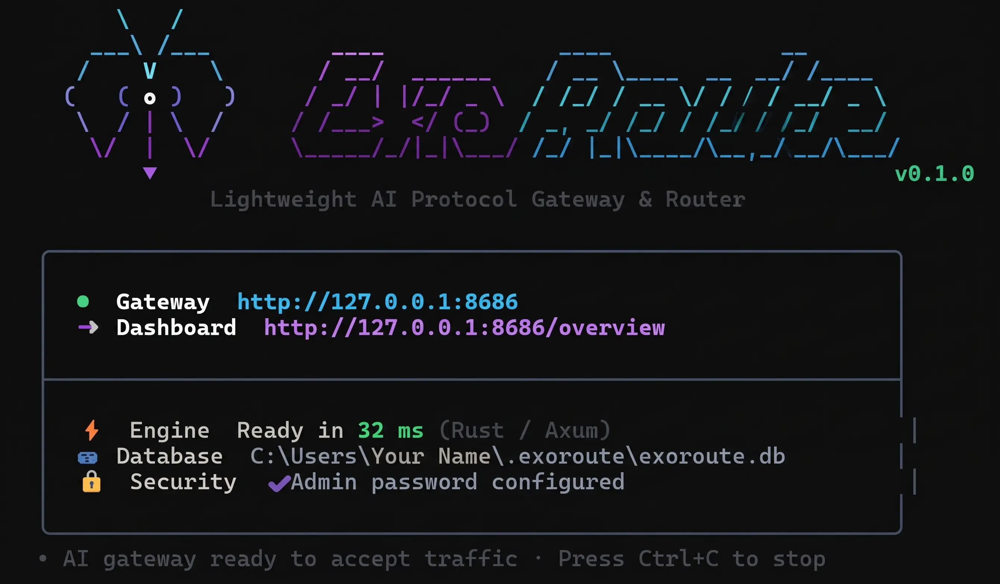

<p align="center">
  
</p>

<h1 align="center">ExoRoute</h1>

<p align="center">
  <strong>The Local-First AI Protocol Gateway & High-Performance Model Router</strong><br>
  Route, failover, translate, and stream across 15+ AI providers through standard OpenAI and Anthropic SDKs with zero GC and microsecond overhead.
</p>

<p align="center">
  <a href="https://github.com/nghiaomg/ExoRoute/releases/tag/v0.1.2"></a>
  
  
  
  
  <a href="LICENSE"></a>
</p>

---

## ⚡ What is ExoRoute?

**ExoRoute** is an ultra-fast, single-binary AI gateway built from the ground up in Rust. It serves as your local central AI routing plane (`127.0.0.1:8686/v1` by default), providing automatic **3-way protocol translation** between:
1. **OpenAI Chat Completions** (`/v1/chat/completions`)
2. **OpenAI Responses API** (`/v1/responses`)
3. **Anthropic Claude Messages** (`/v1/messages`)

Write your client code or configure your developer tools (**Cursor**, **Continue**, **Cline**, **Roo Code**, **Claude Dev**, or your own backend) against your favorite SDK, and talk to **any** AI model from **any** provider without rewriting code or changing client libraries.

<p align="center">
  
</p>

---

## 🚀 Key Features

* ⚡ **Blazing Fast Rust Core**: Zero garbage collection pauses, instant cold starts (<10ms), and predictable memory usage managed via RAII guards.
* 🌐 **Universal 3-Way Protocol Translation**: Seamlessly translate requests, responses, tool calls, and streaming SSE frames between OpenAI Chat, OpenAI Responses, and Anthropic Claude Messages formats.
* ☁️ **12+ Official Cloud AI Providers**: Native adapters with automatic endpoint routing, dynamic model discovery, and credential validation for OpenAI, Anthropic, Google Gemini, DeepSeek, xAI Grok, Mistral, Perplexity, Groq, Cerebras, DashScope, Together, and Fireworks.
* 🛡️ **Combo Fallback & Model Aliases**: Group models into virtual aliases (e.g. `coding-fast`, `reasoning-pro`) with prioritized or round-robin failover. If an upstream encounters rate limits (429) or transient transport errors (5xx), ExoRoute fails over to the next candidate instantly.
* 🔑 **Automatic API Key Rotation**: Register unlimited API keys per provider. ExoRoute rotates keys across requests and automatically switches when an upstream key quota is exhausted or rejected.
* 🌊 **Live Streaming Cache Token Tracking**: Real-time decoding of prompt cache hit and read tokens inside streaming SSE responses—visible immediately in telemetry without requiring page reloads.
* 🔄 **Stream Continuity & Disconnect Recovery**: Optional background worker pool that preserves upstream generation for up to 24 hours if the client disconnects, allowing clients to resume active streams via `Last-Event-ID`.
* 🎨 **7 Visual Theme Archetypes**: Beautiful built-in Svelte 5 dashboard with distinct design systems: Classic Light/Dark (Soft Neo-Brutalism), Tokyo Night (Cyber Slate), Catppuccin Mocha (Pastel Dark), Linear (Minimalist Dark), Cyber Neon (Space Black & Neon), and Minimal Light (Clean Editorial).
* 🔒 **Local-First Security & Egress Guard**: Binds exclusively to loopback interfaces, encrypts stored provider secrets at rest using ChaCha20-Poly1305, defends against SSRF with DNS pinning, and enforces single-use session proofs for database exports/imports.
* 📦 **Zero-Infrastructure Single Binary**: No Docker, no Python runtimes, no external databases (Redis/PostgreSQL). ExoRoute embeds a high-performance LMDB database and the complete dashboard frontend directly into one self-contained binary.

---

## 📋 Supported Provider Matrix

ExoRoute natively supports 15+ official cloud platforms, gateways, and subscription protocols:

| Provider | Preset Type | Default Protocols | Features |
| :--- | :--- | :--- | :--- |
| **OpenAI Direct** | Cloud API | Chat Completions, Responses | Dynamic model discovery, o1/o3 reasoning, vision |
| **Anthropic Direct** | Cloud API | Claude Messages | Auto `anthropic-version`, prompt caching, thinking models |
| **Google Gemini** | Cloud API | Chat Completions | Gemini 2.5 Pro/Flash, multimodality, fast inference |
| **DeepSeek Cloud** | Cloud API | Chat Completions | R1 reasoning token streaming, deepseek-chat |
| **xAI Grok** | Cloud API | Chat Completions | Grok-2, Grok-Vision, real-time context |
| **Mistral AI** | Cloud API | Chat Completions | Codestral, Mistral Large, Pixtral vision |
| **Perplexity AI** | Cloud API | Chat Completions | Sonar search reasoning, online citations |
| **Groq Cloud** | Cloud API | Chat Completions | LPU ultra-high-speed inference, Llama 3.3, Qwen 2.5 |
| **Cerebras Cloud** | Cloud API | Chat Completions | Wafer-scale CS-3 inference (>1,000 tok/sec) |
| **Alibaba DashScope** | Cloud API | Chat Completions | Qwen 2.5 Coder, Qwen-Max, Qwen-Plus |
| **Together AI** | Cloud API | Chat Completions | Open-weights hosting, DeepSeek R1, Llama 3.3 |
| **Fireworks AI** | Cloud API | Chat Completions | Enterprise serverless inference, speculative decoding |
| **OpenRouter** | Gateway | Chat Completions, Responses | 300+ models, multi-provider routing, spend cap tracking |
| **NVIDIA NIM** | Gateway | Chat Completions | NVIDIA hosted microservices, local RPM quota tracking |
| **CodeBuff / Freebuff** | Gateway | Chat Completions | Curated coding models, Bearer auth passthrough |
| **OpenAI Codex** | OAuth | Chat Completions | Browser OAuth subscription flow |
| **Google Antigravity** | OAuth | Chat Completions, Messages | Cloud Code Gemini & Claude access via OAuth |

---

## 🏗️ Architecture

```
                       ┌─────────────────────────────────────────┐
                       │   Client (Cursor, Continue, App, SDK)   │
                       └────────────────────┬────────────────────┘
                                            │ HTTP / SSE
                                            ▼
┌────────────────────────────────────────────────────────────────────────────────────────┐
│                                 ExoRoute Core Gateway                                  │
│                                                                                        │
│   ┌─────────────────────┐    ┌─────────────────────┐    ┌──────────────────────────┐   │
│   │ Loopback Listener   │───▶│ Egress & Auth Guard │───▶│ Protocol Normalizer      │   │
│   │ (127.0.0.1:8686)    │    │ (Token Auth, SSRF)  │    │ (Chat ↔ Resp ↔ Messages) │   │
│   └─────────────────────┘    └─────────────────────┘    └────────────┬─────────────┘   │
│                                                                      │                 │
│   ┌─────────────────────┐    ┌─────────────────────┐                 │                 │
│   │ Embedded LMDB Store │    │ Stream Continuity   │◀────────────────┤                 │
│   │ (Encrypted Secrets) │    │ (24h Disconnect Rec)│                 │                 │
│   └─────────────────────┘    └─────────────────────┘                 │                 │
│                                                                      ▼                 │
│   ┌────────────────────────────────────────────────────────────────────────────────┐   │
│   │                  Combo Routing Engine & Automatic Key Rotator                  │   │
│   │           - Priority or Round-Robin Fallback     - Real-Time Latency Rollup    │   │
│   └────────────────────────────────────────┬───────────────────────────────────────┘   │
└────────────────────────────────────────────┼───────────────────────────────────────────┘
                                             │ HTTPS
                                             ▼
 ┌───────────────────┬───────────────────┬───────────────────┬───────────────────┐
 │  OpenAI Platform  │ Anthropic Claude  │   Google Gemini   │  DeepSeek / Grok  │
 ├───────────────────┼───────────────────┼───────────────────┼───────────────────┤
 │ Groq / Cerebras   │ Mistral / Qwen    │ Together/Fireworks│ OpenRouter / NIM  │
 └───────────────────┴───────────────────┴───────────────────┴───────────────────┘
```

---

## 📦 Quick Installation

### Option 1: npm (Recommended, Cross-Platform)
```sh
npm install -g exoroute
exoroute
```
*The npm launcher downloads the matching ExoRoute release for Linux, macOS, or Windows and verifies its SHA-256 checksum.*

### Option 2: Linux & macOS (Shell Script)
```sh
curl -fsSL https://raw.githubusercontent.com/nghiaomg/ExoRoute/main/install.sh | sh
```

### Option 3: Windows (PowerShell)
```powershell
irm https://raw.githubusercontent.com/nghiaomg/ExoRoute/main/install.ps1 | iex
```

### Option 4: Pre-Built Native Binaries
Download standalone executables directly from [GitHub Releases](https://github.com/nghiaomg/ExoRoute/releases/tag/v0.1.2):
* **Linux (x86_64)**: `exoroute-linux-x86_64.tar.gz`
* **Windows (x86_64)**: `exoroute-windows-x86_64.zip` (`exoroute.exe`)
* **macOS (Apple Silicon & Intel)**: `exoroute-macos.tar.gz`

---

## 🏁 Getting Started

### 1. Launch the Gateway
```sh
exoroute
```
ExoRoute initializes `~/.exoroute/` (`%USERPROFILE%\.exoroute` on Windows), creates a starter `.env`, and opens the dashboard at `http://127.0.0.1:8686`.
On an interactive terminal, it prints the initial one-time admin password.

### 2. Configure Providers & Combos in the Dashboard
1. Open `http://127.0.0.1:8686` in your browser and log in.
2. Under **Providers**, click **Add Provider** and select a preset (e.g. **Anthropic Direct**, **OpenAI Direct**, **Google Gemini**, **DeepSeek**, or **Groq**). Enter your API key.
3. Under **Combos**, create a routing alias (e.g. `coding-model`) and assign provider models in your desired priority order.
4. Under **API Keys**, generate a Gateway API key (e.g. `sk-exo-...`).

### 3. Use ExoRoute with Any Client or Tool

#### 🔹 curl (OpenAI Chat Completions)
```sh
curl http://127.0.0.1:8686/v1/chat/completions \
  -H "Authorization: Bearer YOUR_EXOROUTE_KEY" \
  -H "Content-Type: application/json" \
  -d '{
    "model": "coding-model",
    "messages": [{"role": "user", "content": "Explain Rust memory safety in one sentence."}],
    "stream": true
  }'
```

#### 🔹 curl (Anthropic Claude Messages)
```sh
curl http://127.0.0.1:8686/v1/messages \
  -H "x-api-key: YOUR_EXOROUTE_KEY" \
  -H "anthropic-version: 2023-06-01" \
  -H "Content-Type: application/json" \
  -d '{
    "model": "coding-model",
    "max_tokens": 1024,
    "messages": [{"role": "user", "content": "Why is ExoRoute so fast?"}]
  }'
```

#### 🔹 Python (OpenAI SDK)
```python
from openai import OpenAI

client = OpenAI(
    base_url="http://127.0.0.1:8686/v1",
    api_key="YOUR_EXOROUTE_KEY",
)

response = client.chat.completions.create(
    model="coding-model",
    messages=[{"role": "user", "content": "Hello ExoRoute!"}],
    stream=True,
)

for chunk in response:
    print(chunk.choices[0].delta.content or "", end="")
```

#### 🔹 Python (Anthropic SDK)
```python
import anthropic

client = anthropic.Anthropic(
    base_url="http://127.0.0.1:8686",
    api_key="YOUR_EXOROUTE_KEY",
)

message = client.messages.create(
    model="coding-model",
    max_tokens=1024,
    messages=[{"role": "user", "content": "Translate hello to Vietnamese."}],
)
print(message.content[0].text)
```

#### 🔹 Cursor / Continue.dev / Cline / Roo Code
Configure your AI coding assistant with:
* **Base URL**: `http://127.0.0.1:8686/v1`
* **API Key**: `YOUR_EXOROUTE_KEY`
* **Model**: Your configured Combo name (e.g. `coding-model` or `gpt-4o`, `claude-3-7-sonnet-20250219`)

Visit `http://127.0.0.1:8686/docs` for step-by-step interactive configuration guides for each IDE extension!

---

## 🎨 Theme Design System

ExoRoute includes 7 meticulously crafted visual archetypes designed for comfort, focus, and aesthetics:

* ☀️ **Classic Light**: Soft Neo-Brutalism with 2px ink borders, hard offset drop shadows, and signature brand orange.
* 🌑 **Classic Dark**: High-contrast obsidian slate surfaces with subtle orange accents.
* 🌃 **Tokyo Night**: Cyberpunk indigo and midnight slate with vibrant neon violet and cyan accents.
* ☕ **Catppuccin Mocha**: Soothing pastel-dark palette specifically calibrated to reduce eye strain.
* 📐 **Linear**: Ultra-refined monochrome minimalist dark UI with clean subtle borders.
* ⚡ **Cyber Neon**: Deep OLED pitch black paired with high-voltage neon yellow, green, and hot pink highlights.
* 📰 **Minimal Light**: Crisp, clean editorial light mode optimized for documentation and well-lit rooms.

Themes redefine border radiuses, shadows, surface elevations, and typographic hierarchies with zero layout shift or first-load flicker.

---

## 🔒 Security & Data Invariants

ExoRoute is designed strictly for local-first operations:
* **Loopback Enforcement**: ExoRoute strictly binds to `127.0.0.1` or `::1`. Remote deployments should use a TLS reverse proxy (Caddy/Nginx) forwarding to loopback.
* **Encrypted Secrets**: Provider keys and master secrets are encrypted with **ChaCha20-Poly1305** at rest.
* **Egress Validation & DNS Pinning**: Egress requests protect against SSRF by validating and pinning resolved IP addresses before establishing connections.
* **Single-Use Reauthentication**: Database export/import workflows require short-lived, session-bound proof tokens generated via explicit password verification.

---

## 🛠️ Building from Source

### Prerequisites
* Rust toolchain (1.88+ recommended)
* Node.js (18+) & npm
* Linux, macOS, or Windows

```sh
# 1. Clone repository
git clone https://github.com/nghiaomg/ExoRoute.git
cd ExoRoute

# 2. Build Svelte 5 frontend assets
cd web
npm ci
npm run build
cd ..

# 3. Build & Run release binary
cargo run --release
```

### Running Tests
```sh
# Run Rust test suite (650+ tests)
cargo test --workspace --all-features

# Run Frontend tests
cd web && npm test
```

---

## 📄 Documentation & Releases

* Detailed release notes: [RELEASE_v0.1.2.md](docs/releases/RELEASE_v0.1.2.md)
* Built-in interactive documentation: Navigate to `http://127.0.0.1:8686/docs` after starting ExoRoute.

---

## 📜 License

Licensed under the [MIT License](LICENSE).
